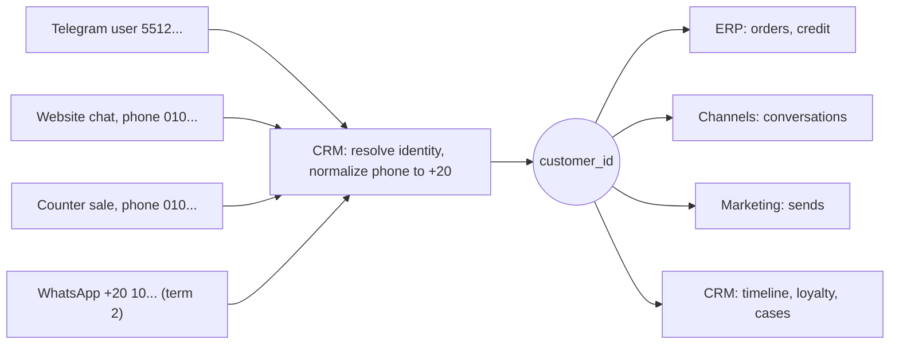

# Modules

> From [technical-structure.md](https://github.com/puagraduationproject/graduationproject/blob/main/technical-structure.md) section 2.2 to 2.8. When the design changes, this page changes with it.

## Who owns what

| Data | Owner |
|------|-------|
| Businesses, members, roles, locations, templates, packs on per business, audit, notifications | Core |
| Items, recipes, stock, sales, orders, payments, shifts, suppliers, purchases, credit, expenses | ERP |
| Customers, identities, timeline, loyalty, support cases, bookings, segments, consent | CRM |
| Channel accounts, conversations, messages, auto-replies | Channels |
| Website settings and pages, search presence, reviews | Store website |
| Brand kit, design templates, designs, posts | Studio |
| Offers, campaigns | Marketing |
| Staff profiles, rota, attendance, tasks | Team |
| Summary numbers | Reports |
| Skills, plans, approvals, AI permission settings, memory, threads, knowledge, AI action log | AI layer (its own data only; business data only through tools) |

## One database, one schema per module

| Schema | Module |
|--------|--------|
| `core` | Core |
| `erp` | ERP |
| `crm` | CRM |
| `channels` | Channels |
| `store` | Store website |
| `studio` | Studio |
| `marketing` | Marketing |
| `team` | Team |
| `reports` | Reports |
| `ai` | AI layer |

Each module connects with its own database user, which has rights only on its
own schema. The AI layer's user cannot see any business schema.

## One thing, one ID, everywhere

Each module builds its own part with its own tools. What holds them together is
that every shared thing has **one owner and one ID**, and every other module
stores only that ID.

| Thing | Owner | ID | Used by |
|-------|-------|----|---------|
| Business | Core | `business_id` | Every module, every table |
| Member (a person in the business) | Core | `membership_id` | ERP (shifts, sales), Team, Channels (assigned to), audit |
| Location (branch) | Core | `location_id` | ERP, Team, Store |
| **Customer** | CRM | `customer_id` | ERP (orders, credit), Channels (conversations), Marketing (sends), Store (orders), AI (memory notes) |
| Item and variant | ERP | `item_id`, `variant_id` | Store (menu), Studio (designs), Marketing (offers), CRM (usual order) |
| Order | ERP | `order_id`, shown as `#1042` | CRM (cases, timeline), Channels (notifications), Marketing (results) |
| Conversation | Channels | `conversation_id` | CRM (cases), AI (who it is talking to) |
| Design, post | Studio | `design_id`, `post_id` | Channels (publishing), Store (site images), Marketing (campaigns) |

The ID types, money, times, statuses and the event envelope are defined once in
the contracts, so every module, the app and the AI use exactly the same shapes.

## One customer, on every channel and in every module

A customer can arrive by Telegram, by the website chat, at the counter with a
phone number, or later by WhatsApp or Instagram. They are always **one**
`customer_id`, owned by CRM.

1. Whoever meets a customer first (Channels, Store, the sales screen) asks CRM
   to **resolve** the identity it has: a phone, a Telegram ID, an Instagram
   handle. This is a service call, not a database read
2. CRM normalizes it, finds the customer or creates one, and returns
   `customer_id`. The caller stores only that ID
3. A second identity for the same person (their Telegram and their phone) is
   linked to the same customer when it is proven (the customer gives the phone
   in the chat), or becomes a merge **suggestion** for the owner
4. **Merging** never breaks references: the old record is marked
   `merged_into`, CRM emits `CustomerMerged`, and old IDs keep resolving to the
   new one
5. **Forgetting a customer** (on request): CRM removes the personal data and
   emits `CustomerForgotten`; every module that holds a copy (order snapshots,
   message bodies, AI notes) removes or masks its own

## The context every call and event carries

Every tool call, service call and event carries the same context:

| Field | Why |
|-------|-----|
| `business_id` | Row-level security and the business wall |
| `actor` | Who did it: a member, the AI (and who it acts for), or the system |
| `correlation_id` | One ID for everything caused by one request, so one customer message can be followed through every module |
| `idempotency_key` | A retried call writes once |
| `face` | Customer or owner, for the AI's calls |

Every event uses one envelope: `event_id`, `type`, `version`, `business_id`,
`occurred_at`, `actor`, `correlation_id`, `causation_id` (the event that caused
it), the IDs it is about (`customer_id`, `order_id`, ...), and its data.

## How a process crosses modules

No module reaches into another. A process that crosses modules is a chain of
tool calls and events, each step done by the module that owns it:

| Process | The chain |
|---------|-----------|
| Chat order | Channels gets the message and resolves the customer with CRM; the AI calls `erp.create_order`; ERP emits `OrderCreated`; CRM adds activity and points; Channels sends the confirmation; Reports counts it |
| Order ready | ERP emits `OrderReady`; Channels tells the customer on the conversation they ordered from |
| Complaint with refund | CRM opens the case; ERP refunds (`RefundIssued`); CRM records it on the case and the timeline; Channels sends the message |
| Post with an offer | Marketing creates the offer; Studio makes the design and the post; Channels publishes it; ERP orders that use the offer feed Marketing's results |

Rules:

- Each step is idempotent, so a retry never doubles anything
- If a later step fails, the earlier ones are undone with their undo actions, or
  the process waits and retries; it never leaves half a process silently
- Long processes that wait (an approval, a scheduled post) are run by the
  planner or the scheduler, which survive restarts

## References across modules

- Inside a module's schema, references are real database links
- Across schemas there are no database links: only IDs, checked by a service
  call when written ("does this customer exist in this business?")
- Shared things are **archived, never deleted**, so an ID stored elsewhere
  never points at nothing
- Each module that shows another module's data (a customer's orders on the
  customer page) asks the owner through its service, or keeps a small cache
  updated by events, like `customer_stats`
- An end-to-end test runs each process in 2.7 through every module, and a
  contract test checks that each module accepts and returns the shared shapes
